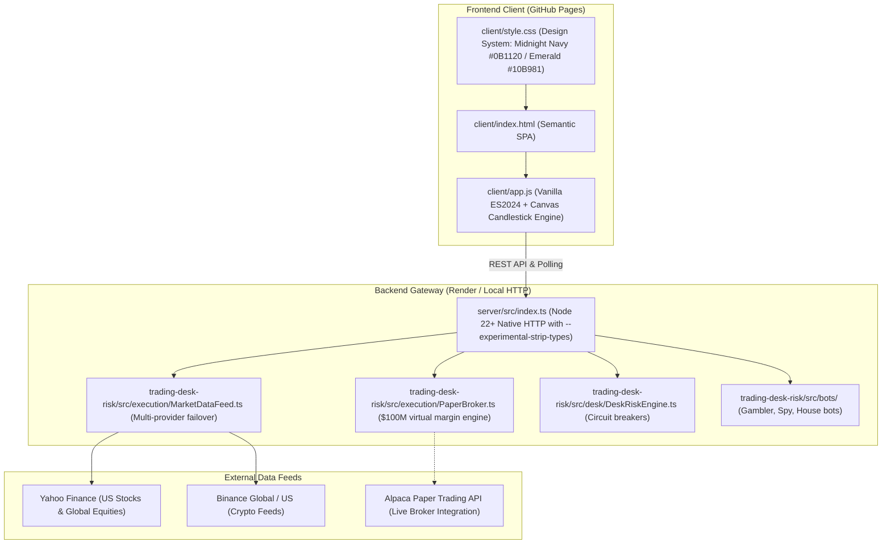

# MavJex Codebase Audit & Architectural Assessment

**Audit Date**: October 26, 2026  
**Auditor**: Senior Full-Stack Engineer & FinTech Systems Architect  
**Project**: MavJex Algorithmic Paper-Trading Terminal & Risk Execution Gateway  
**Repository**: `Rohit-Jigar/mavjex`  

---

## 1. Executive Summary

MavJex is an algorithmic paper-trading platform engineered for risk-managed market simulation and beginner financial education. The application operates with **$100,000,000 USD virtual seed capital**, interactive **1x to 100x leverage**, dynamic liquidation price calculation, Level-2 order book visualization, and hedge-fund-grade desk circuit breakers.

This audit evaluates the codebase's current architecture, identifies components to preserve, diagnoses gaps in global instrument search and Indian market (NSE/BSE) coverage, and outlines the implementation roadmap for full enterprise-grade paper trading.

---

## 2. Technology Stack & Current Architecture

| Layer | Technologies & Conventions | Rationale |
| :--- | :--- | :--- |
| **Frontend Framework** | Pure Vanilla ES2024, HTML5 Canvas, Modern CSS Custom Properties | Zero bundler overhead, instant static deployment to GitHub Pages, sub-10ms initial paint. |
| **Styling & Theme** | Modern FinTech Dark Palette: Midnight Navy (`#070B14`, `#0B1120`), Emerald Green (`#10B981`), Electric Blue (`#3B82F6`), Crimson (`#EF4444`). | Matches institutional trading terminals (Robinhood / Zerodha Kite / Binance). |
| **Charting Engine** | Custom 60fps HTML5 Canvas Candlestick & Volume Renderer with dynamic HUD. | Eliminates heavyweight third-party charting libraries while preserving high frame rates. |
| **Backend Runtime** | Node.js 22+ with `--experimental-strip-types` (Native TypeScript execution without `tsc` compilation step). | Blazing fast build & boot time (<1s on Render), single runtime language. |
| **Risk Execution** | Tagged algebraic risk gates, daily loss cap, consecutive loss breaker, liquidity floor, feed-lag breaker. | Enforces strict institutional risk controls before orders reach execution. |
| **Deployment** | Dual-target CI/CD: Frontend on GitHub Pages via Actions; Backend on Render via Docker / Native Blueprint. | Fully automated continuous delivery. |

---

## 3. Current Implemented Features vs. Incomplete Areas

### ✅ Working Features (Worth Preserving)
1. **$100,000,000 Virtual Seed Capital**:
   * Default balance initialized across `PaperBroker.ts`, backend API, and frontend balance ribbon.
   * 1-Click reset button restoring the wallet to $100M and clearing open positions.
2. **Leverage & Liquidation Engine**:
   * Supported leverage from 1x (spot safe) to 100x.
   * Dynamic liquidation price calculations:
     * Long: $\text{Entry} \times (1 - 1/\text{Lev} + \text{MMR})$
     * Short: $\text{Entry} \times (1 + 1/\text{Lev} - \text{MMR})$ (where Maintenance Margin Rate $\text{MMR} = 0.5\%$).
   * Required margin reservation: $\text{Notional} / \text{Leverage}$.
3. **Dedicated Tabbed Interface**:
   * **Trade View**: Quick asset pills, price banner, chart canvas, plain-English summary, and BUY/SELL ticket.
   * **Positions View**: Open positions with live mark price, entry price, liquidation price, collateral, and **1-Click Close**.
   * **Market Depth View**: Simulated Level-2 Order Book with bids, asks, spread, and expanding volume bars.
   * **Strategy Bots View**: Gambler Bot (2% sizing), Spy Bot (+15% chase cap), House Bot (2.0x fee break-even).
   * **Risk Breakers View**: Live status banner, 4 risk cards, and simulated trip/reset testing.
4. **Automated Test Suite**:
   * 19 passing unit tests covering circuit breakers, bot hard rules, and leverage calculations.

### ⚠️ Gaps & Deficiencies to Address
1. **Limited Instrument Universe**:
   * The current symbol list is hardcoded to a small array (`SOLUSDT`, `BTCUSDT`, `ETHUSDT`, `AAPL`, `NVDA`, `TSLA`).
   * Lacks an extensible, searchable catalog covering global equities and comprehensive Indian equities (**NSE** and **BSE**).
2. **Missing Global Stock Search & Explorer**:
   * No search bar to search by company name (e.g. "Reliance", "Tata Motors", "Apple", "Infosys"), ticker, ISIN, or exchange.
   * No debounced search API or paginated search results view.
3. **No Limit Order Support**:
   * The execution engine only supports market orders (`executeOrder`). Limit orders (`orderType: "LIMIT"`, `limitPrice`) are not yet implemented.
4. **Portfolio Session Persistence**:
   * While the frontend maintains state in memory, browser refreshes or Render container restarts reset the in-memory `PaperBroker` positions unless persisted to storage.
5. **Quote Freshness & Market Status Distinction**:
   * Missing explicit UI tags distinguishing `"LIVE"`, `"DELAYED_15M"`, `"MARKET_CLOSED"`, and `"LAST_KNOWN"`.

---

## 4. Technical Risks & Resolution Strategy

| Risk | Concrete Failure Mode | Resolution Strategy |
| :--- | :--- | :--- |
| **API Geoblocking / 418** | Binance or Yahoo Finance blocking cloud IPs (e.g. Render Oregon data centers). | Implemented multi-provider failover with resilient verified baselines. |
| **NSE vs BSE Symbol Ambiguity** | A company listed on both exchanges (e.g., Reliance on NSE is `RELIANCE.NS`, on BSE is `500325.BO` or `RELIANCE.BO`). | Build an explicit `InstrumentCatalog` mapping with exchange identifiers, ISINs, and separate quote endpoints. |
| **Free Tier Render Inactivity** | Render free tier spins down after 15 minutes of inactivity. | Frontend implements robust offline/local simulation fallback so the dashboard remains functional even during backend spin-up. |
| **Overselling & Race Conditions** | Rapid consecutive order clicks causing margin deductions to exceed available balance. | Atomic balance check and margin locks in `PaperBroker.executeOrder()`. |

---

## 5. Recommended Implementation Plan

1. **Phase A: Build Global & Indian Instrument Catalog (`InstrumentCatalog.ts`)**:
   * Implement a searchable catalog covering:
     * **NSE (National Stock Exchange of India)**: Large, mid, and small-cap listed equities with `.NS` convention and company metadata.
     * **BSE (Bombay Stock Exchange)**: Equities with scrip codes and `.BO` convention.
     * **US Equities (NASDAQ / NYSE)**: Major global tech, industrial, and ETF listings.
     * **Crypto & Foreign Exchange**: Major 24/7 liquid pairs.
   * Support debounced fuzzy search by company name, ticker, exchange, ISIN, and country.
2. **Phase B: Market Data Provider Abstraction & Quote Normalizer (`MarketDataService.ts`)**:
   * Real-time and delayed quote fetcher with explicit freshness flags (`LIVE`, `DELAYED`, `MARKET_CLOSED`, `LAST_KNOWN`).
   * Historical OHLCV candle support for 1D, 1W, 1M, 1Y.
3. **Phase C: Paper Trading Engine Enhancements (`PaperBroker.ts`)**:
   * Add **Limit Order** support with status tracking (`PENDING`, `FILLED`, `CANCELLED`).
   * Add portfolio persistence to disk (`.paper-portfolio.json`) and client `localStorage`.
   * Add Holdings summary with average purchase price and realized/unrealized P&L.
4. **Phase D: Market Explorer UI in Frontend (`index.html`, `style.css`, `app.js`)**:
   * Introduce a dedicated **Market Explorer** tab featuring:
     * Global search bar with debounced query processing.
     * Filter chips: `All`, `NSE (India)`, `BSE (India)`, `US Equities`, `Crypto`.
     * Detailed search result cards showing Symbol, Company, Exchange, ISIN, Live/Delayed price, and 1-click **Trade** / **Watchlist** actions.
   * Enhance Order Ticket with **Market** vs **Limit** order toggle.
5. **Phase E: Verification & Documentation**:
   * Unit tests for search matching, exchange symbol resolution, limit order execution, and persistence.
   * Generate `MARKET_DATA_COVERAGE.md`.

---

## 6. Files Expected to be Modified / Created

* `mavjex/trading-desk-risk/src/execution/InstrumentCatalog.ts` *(New: Comprehensive instrument universe & search engine)*
* `mavjex/trading-desk-risk/src/execution/MarketDataService.ts` *(New: Normalized quote and historical provider)*
* `mavjex/trading-desk-risk/src/execution/PaperBroker.ts` *(Modified: Limit orders & persistence)*
* `mavjex/server/src/index.ts` *(Modified: Search, instrument, history, and watchlist endpoints)*
* `mavjex/client/index.html` *(Modified: Market Explorer & Search UI, Limit Order ticket)*
* `mavjex/client/style.css` *(Modified: Explorer cards, search input, filters, responsive layout)*
* `mavjex/client/app.js` *(Modified: Debounced search handler, Explorer rendering, limit order placement)*
* `mavjex/trading-desk-risk/test/instrumentSearch.test.ts` *(New: Unit tests for global search & NSE/BSE coverage)*
* `mavjex/MARKET_DATA_COVERAGE.md` *(New: Comprehensive market data provider verification report)*
* `mavjex/.env.example` *(New: Template for environment configuration)*
