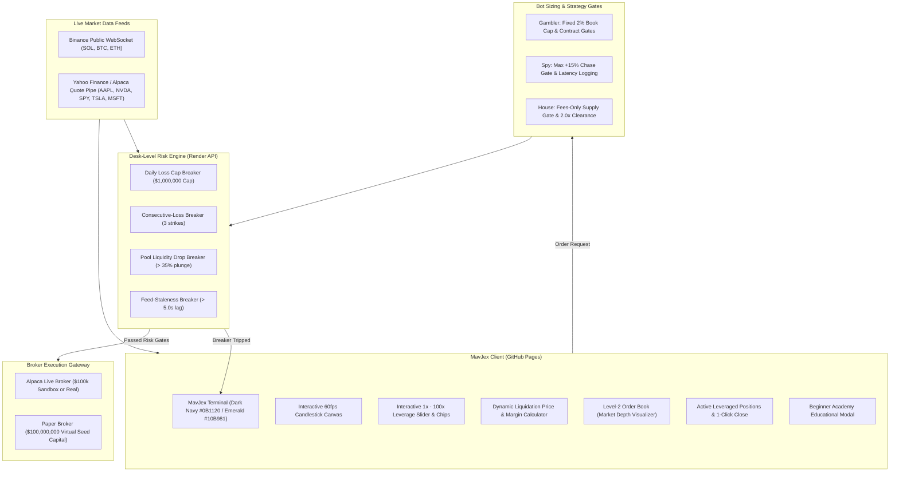

<div align="center">


# MavJex
### **Simulate. Analyze. Evolve.**

[](https://github.com/Rohit-Jigar/mavjex/actions/workflows/ci.yml)
[](https://github.com/Rohit-Jigar/mavjex/actions/workflows/deploy-frontend.yml)
[](LICENSE)
[](https://nodejs.org/)

**A beginner-friendly, production-grade dual trading platform featuring $100,000,000 USD virtual seed capital for risk-free learning, 1x to 100x leverage, dynamic liquidation calculations, Level-2 market depth, desk-level circuit breakers, and live Alpaca execution.**

[🌐 Live Terminal (GitHub Pages)](https://rohit-jigar.github.io/mavjex/) • [⚡ Render API Backend](https://mavjex-api.onrender.com)

</div>

---

## 📸 Social Sharing Preview (OpenGraph)

When sharing your deployed MavJex link on **Twitter / X, LinkedIn, Discord, Telegram, or WhatsApp**, the link automatically generates rich metadata with our custom fintech branding:

```
┌─────────────────────────────────────────────────────────────────┐
│  [Preview Image: MavJex Fintech Brand Identity Board]           │
│                                                                 │
│  MavJex — Simulate. Analyze. Evolve.                            │
│  Next-Gen Dual Trading Terminal: Practice with $100M Virtual    │
│  Seed or Trade Live with Alpaca. 1x-100x Leverage, Dynamic      │
│  Liquidation Calculator & Desk Circuit Breakers.                │
│  rohit-jigar.github.io/mavjex                                  │
└─────────────────────────────────────────────────────────────────┘
```

---

## 🏛️ System Architecture



---

## ⚡ Key Highlights & Beginner-Friendly Capabilities

### 🎓 1. $100,000,000 USD Virtual Seed Capital
Beginners start with **$100,000,000 USD** in dummy seed capital. It functions exactly like real money on real-time market data across cryptocurrencies (SOL, BTC, ETH) and US stocks (AAPL, NVDA, SPY, TSLA, MSFT), completely removing the fear of losing real savings while learning.

### ⚡ 2. Interactive Leverage (1x to 100x)
* **1x (Spot)**: Full cash backing, impossible to liquidate above $0.
* **2x to 10x (Standard)**: Day-trading leverage with moderate risk.
* **20x to 50x (Aggressive)**: High volatility and narrow margin buffers.
* **100x (Maximum)**: 100x capital efficiency for advanced simulation.

### 🛡️ 3. Dynamic Liquidation Price & Margin Calculator
Before placing any order, the real-time ticket dynamically displays:
* **Required Margin**: Collateral required (`Notional / Leverage`).
* **Estimated Liquidation Price**:
  * **Long**: $\text{Entry Price} \times \left(1 - \frac{1}{\text{Leverage}} + \text{MMR}\right)$
  * **Short**: $\text{Entry Price} \times \left(1 + \frac{1}{\text{Leverage}} - \text{MMR}\right)$
  *(where Maintenance Margin Rate $\text{MMR} = 0.5\%$)*
* **Distance to Liquidation**: Exact percentage drop/rise before margin is consumed.
* **Contextual Risk Gauge**: Visual alert indicators (Green Safe, Yellow Moderate, Orange High, Red Extreme).

### 📊 4. Level-2 Order Book / Market Depth Ladder
Inspired by Binance and Zerodha Kite, learners can see real-time buyer and seller bid/ask queues with proportional visual depth bars and live spread metrics.

### 📑 5. Active Positions Table & 1-Click Close
View open leveraged trades with live Mark Price, Liquidation Price, Margin, and floating Unrealized P&L ($ and %). Close any position instantly in 1 click to lock in profits or cap losses.

### 🔄 6. 1-Click Reset to $100M
Learners can reset their virtual balance back to $100,000,000 USD anytime with a single click to experiment with fresh strategies.

### 📖 7. Built-in Beginner Academy & Contextual Tooltips
Interactive tooltips (`ⓘ`) explain Leverage, Margin, Liquidation, Stop Loss, Long vs Short, and Desk Risk Breakers in plain English.

---

## 🚀 Quick Start (Local Development)

### Prerequisites
* **Node.js 22.0.0+**
* **Git**

### 1. Run the Backend Service
```bash
node --experimental-strip-types mavjex/server/src/index.ts
```
The server will start at `http://localhost:3001` with live market feeds and the $100M paper engine.

### 2. Run the Frontend Dashboard
Open `mavjex/client/index.html` in your browser or run:
```bash
npx serve mavjex/client
```

---

## 🌐 Production Deployment Guide

### A. Deploy Backend to Render (Blueprint)
1. Sign in to [Render](https://render.com).
2. Click **New +** > **Blueprint**.
3. Select this repository. Render detects [`render.yaml`](render.yaml) automatically:
   * **Service**: `mavjex-api`
   * **Runtime**: Node.js 22+
   * **Start Command**: `node --experimental-strip-types mavjex/server/src/index.ts`
4. Add environment variables:
   * `ALPACA_API_KEY`: Your Alpaca Key.
   * `ALPACA_SECRET_KEY`: Your Alpaca Secret.
5. Click **Apply**.

### B. Deploy Frontend to GitHub Pages
1. Go to repository **Settings** > **Pages**.
2. Under **Build and deployment** > **Source**, choose **GitHub Actions**.
3. Push to `main`. The workflow [`.github/workflows/deploy-frontend.yml`](.github/workflows/deploy-frontend.yml) deploys the frontend automatically to:
   `https://rohit-jigar.github.io/mavjex/`

---

## 🧪 Automated Test Suite

Run the 19 automated tests validating the desk risk engine, bot rules, and leverage mechanics:

```bash
node --experimental-strip-types --test "trading-desk-risk/test/*.test.ts"
```

Output:
```
✔ Desk Breaker: Daily Loss Cap halts entries when breached
✔ Desk Breaker: Consecutive Loss Breaker halts entries when streak hits threshold
✔ Desk Breaker: Liquidity-Drop Breaker halts on low floor or sudden drain
✔ Desk Breaker: Feed-Lag Breaker stops entries when data is more than N seconds stale
✔ Gambler Hard Rule: Fixed % size strictly enforced (stops Martingale / sizing up)
✔ Gambler Hard Rule: Contract Gates reject honeypots, mintable tokens, and paused trading
✔ House Hard Rule 1: Never hold or sell own supply (Fees only, zero rug risk)
✔ House Hard Rule 2: Break-even gate requires fee revenue >= 2x launch costs
✔ House Hard Rule 3: Daily launch budget hard stop halts further launches
✔ PaperBroker: initializes with $100,000,000 virtual seed capital default
✔ PaperBroker: calculates liquidation price correctly across leverage tiers (1x to 100x)
✔ PaperBroker: executes leveraged order requiring only fractional margin from $100M cash
✔ Live Execution Gateway: executes in PAPER mode with virtual cash & updates desk PnL
✔ Live Execution Gateway: fails-closed if ALPACA_LIVE mode selected without verified credentials
✔ Spy Hard Rule: copy skipped when leader is too far ahead
✔ Spy Hard Rule: copy allowed when quote is within max chase limit
✔ Spy Hard Rule: mirror exits immediately and block buys into leader exit
✔ Spy Hard Rule: demote wallet after three losing copies in a row
✔ Spy Hard Rule: cap allocation per wallet
ℹ tests 19
ℹ pass 19
ℹ fail 0
```

---

## 📄 License
Released under the [MIT License](LICENSE).
