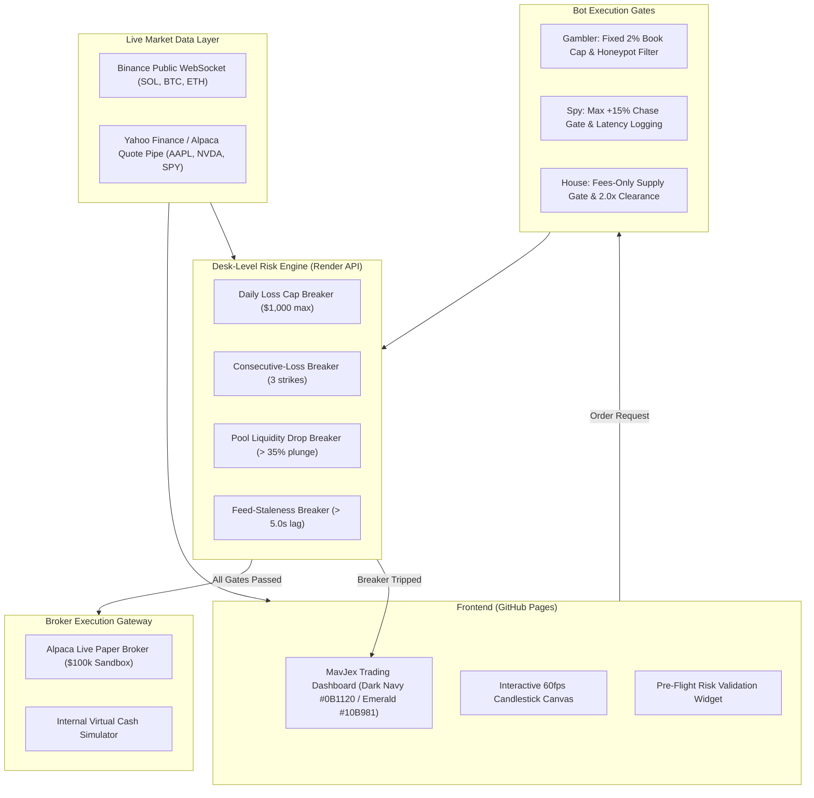

<div align="center">


# MavJex
### **Simulate. Analyze. Evolve.**

[](https://github.com/Rohit-Jigar/mavjex/actions/workflows/ci.yml)
[](https://github.com/Rohit-Jigar/mavjex/actions/workflows/deploy-frontend.yml)
[](LICENSE)
[](https://nodejs.org/)

**A high-performance algorithmic paper-trading terminal with desk-level circuit breakers, live streaming market ticks, and bot failure-mode execution gates.**

[Live Frontend Demo](https://rohit-jigar.github.io/mavjex/) • [API Backend on Render](https://mavjex-api.onrender.com)

</div>

---

## 📸 Social Sharing Preview (OpenGraph)

When sharing your deployed MavJex link on **Twitter / X, LinkedIn, Discord, Telegram, or WhatsApp**, the link automatically generates rich metadata with our custom fintech branding:

```
┌─────────────────────────────────────────────────────────────────┐
│  [Preview Image: MavJex Fintech Brand Identity Board]           │
│                                                                 │
│  MavJex — Simulate. Analyze. Evolve.                            │
│  Next-Gen Algorithmic Paper-Trading Terminal with Real-Time     │
│  Market Ticks, Desk-Level Circuit Breakers, and Strict Order-   │
│  Path Risk Gates.                                               │
│  rohit-jigar.github.io/mavjex                                  │
└─────────────────────────────────────────────────────────────────┘
```

---

## 🏛️ System Architecture



---

## ⚡ Key Features

1. **Brand Identity**: Custom **M + J + Upward Growth Arrow** monogram logo in an Emerald Green (`#10B981`) and Electric Blue (`#3B82F6`) gradient over Midnight Navy (`#0B1120`).
2. **Interactive Candlestick Engine**: Custom HTML5 Canvas renderer plotting real-time candlestick wicks, bodies, dynamic volume bars, and responsive crosshair HUDs.
3. **Desk-Level Circuit Breakers**:
   * **Daily Loss Cap**: Halts desk operations when aggregate loss reaches threshold.
   * **Consecutive-Loss Breaker**: Enforces a cooling-down halt after 3 consecutive losses.
   * **Liquidity-Drop Breaker**: Blocks entries when pool liquidity plunges.
   * **Feed-Lag Breaker**: Automatically rejects stale data (e.g. weekend closed equity markets).
4. **Alpaca Broker Integration**: Verified paper-trading client connecting to live market accounts with real-time portfolio balance, buying power, and position tracking.
5. **Universal Responsiveness**: Engineered for desktop multi-monitor terminals, iPads/tablets, and notched smartphones (iOS & Android).

---

## 🚀 Quick Start (Local Development)

### Prerequisites
* Node.js 22.0.0 or higher.
* Git.

### 1. Run the Backend API Server
```bash
node --experimental-strip-types mavjex/server/src/index.ts
```
The server will start at `http://localhost:3001` with live Binance & Yahoo Finance pipes and Alpaca integration.

### 2. Run the Frontend Dashboard
Open `mavjex/client/index.html` in any modern web browser or serve it locally:
```bash
npx serve mavjex/client
```

---

## 🌐 Production Deployment Guide

### A. Deploy Backend to Render (1-Click Blueprint)

1. Fork or push this repository to your GitHub account.
2. Sign in to [Render](https://render.com).
3. Click **New +** > **Blueprint**.
4. Select your repository. Render will automatically detect [`render.yaml`](render.yaml) and configure:
   * **Service Name**: `mavjex-api`
   * **Runtime**: Node.js 22+
   * **Start Command**: `node --experimental-strip-types mavjex/server/src/index.ts`
5. In the Render Dashboard under **Environment Variables**, add:
   * `ALPACA_API_KEY`: Your Alpaca Paper API Key.
   * `ALPACA_SECRET_KEY`: Your Alpaca Paper Secret Key.
6. Click **Apply**. Your backend is live!

### B. Deploy Frontend to GitHub Pages

1. In your GitHub repository, navigate to **Settings** > **Pages**.
2. Under **Build and deployment** > **Source**, choose **GitHub Actions**.
3. Push to the `main` branch. The included workflow [`.github/workflows/deploy-frontend.yml`](.github/workflows/deploy-frontend.yml) will build and deploy the dashboard automatically!
4. Your site will be live at:
   `https://rohit-jigar.github.io/mavjex/`

---

## 🧪 Automated Test Suite

Every circuit breaker and hard rule has automated unit tests that fail the build if any breaker stops firing:

```bash
node --experimental-strip-types --test "trading-desk-risk/test/*.test.ts"
```

Output:
```
✔ Desk Breaker: Daily Loss Cap halts entries when breached (2.19ms)
✔ Desk Breaker: Consecutive Loss Breaker halts entries when streak hits threshold (0.40ms)
✔ Desk Breaker: Liquidity-Drop Breaker halts on low floor or sudden drain (0.42ms)
✔ Desk Breaker: Feed-Lag Breaker stops entries when data is more than N seconds stale (0.36ms)
✔ Gambler Hard Rule: Fixed % size strictly enforced (stops Martingale / sizing up) (2.40ms)
✔ Gambler Hard Rule: Contract Gates reject honeypots, mintable tokens, and paused trading (0.61ms)
✔ House Hard Rule 1: Never hold or sell own supply (Fees only, zero rug risk) (2.47ms)
✔ House Hard Rule 2: Break-even gate requires fee revenue >= 2x launch costs (0.49ms)
✔ House Hard Rule 3: Daily launch budget hard stop halts further launches (0.39ms)
✔ Live Execution Gateway: executes in PAPER mode with virtual cash & updates desk PnL (3.03ms)
✔ Live Execution Gateway: fails-closed if ALPACA_LIVE mode selected without verified credentials (1.33ms)
✔ Spy Hard Rule: copy skipped when leader is too far ahead (3.42ms)
✔ Spy Hard Rule: copy allowed when quote is within max chase limit (0.34ms)
✔ Spy Hard Rule: mirror exits immediately and block buys into leader exit (0.32ms)
✔ Spy Hard Rule: demote wallet after three losing copies in a row (1.24ms)
✔ Spy Hard Rule: cap allocation per wallet (0.42ms)
```

---

## 🔒 Security & Safe Trading

* **Zero-Custody Principle**: The bot never requires withdrawal permissions.
* **Fail-Closed Architecture**: Live execution is blocked unless authorized API keys are provided.
* **Environment Integrity**: `.env` is permanently excluded via `.gitignore` to prevent secret leaks.

---

## 📄 License

MIT License. Designed and engineered for **MavJex**.
